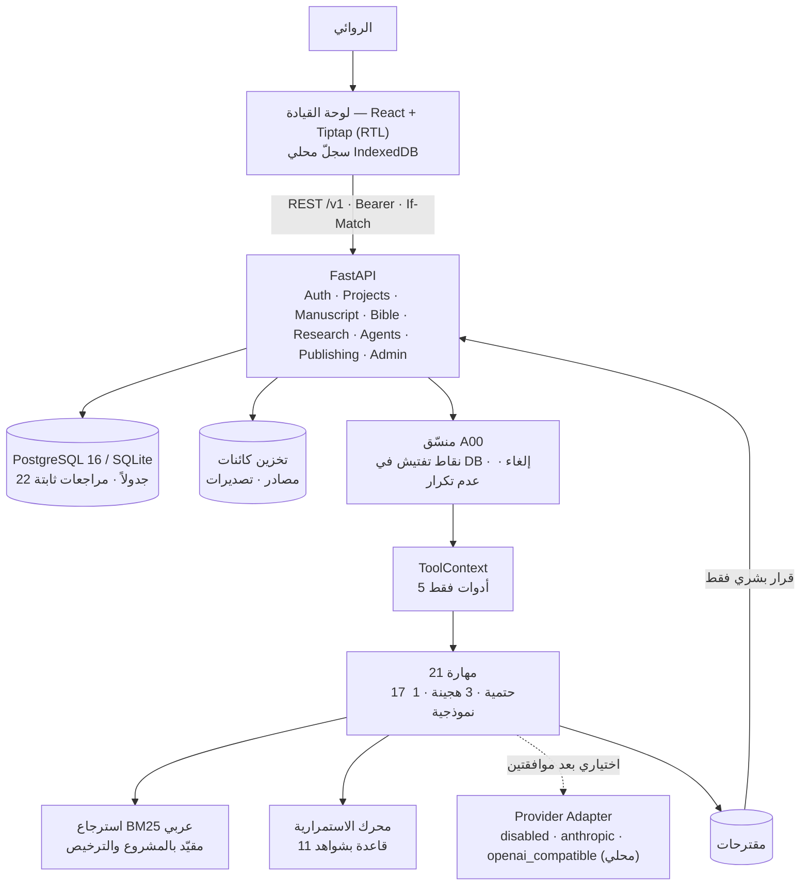
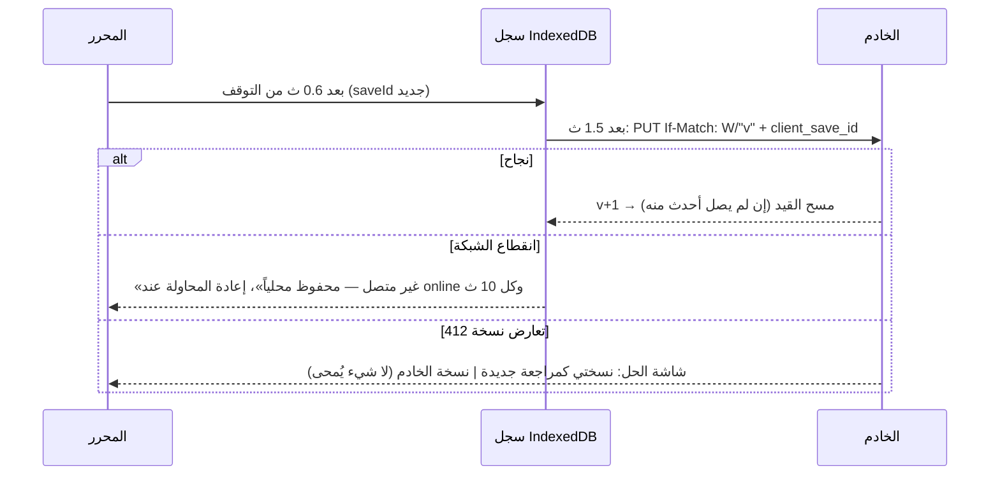

# المعمارية — كاتب

## المبادئ المطبّقة بنيوياً

| المبدأ | الآلية |
|---|---|
| سيادة المؤلف | صلاحية `decide_proposals` و`approve_canon` للمالك؛ الوكيل لا يملك كائناً يستطيع به القبول |
| عدم محو التاريخ | `Revision` ثابتة (حارس ORM يرفع استثناءً عند أي تعديل)، استعادة = مراجعة جديدة، حذف العقد ناعم |
| التحكم بالتزامن | ETag ضعيف = رقم النسخة؛ `If-Match` إلزامي (428)، اختلاف النسخة 412، مقترح متقادم 409 |
| عدم التكرار | `client_save_id` للمراجعات، `idempotency_key` للتشغيلات، بصمة للمقترحات والتعارضات |
| العزل | كل استعلام يمر عبر `access_for()`؛ غير العضو يرى 404 |
| البيانات غير الموثوقة | فحص حقن عند الفهرسة + غلاف بيانات + نموذج القدرات |
| الخصوصية | المزود معطّل افتراضياً؛ موافقة مشروع + إقرار تشغيل + تأكيد مخاطرة عالية؛ سجل تدقيق منقّح |

## دورة حفظ المستند

## تخطيط الواجهة

مساحة الكتابة ثلاثية قابلة للإخفاء (Ctrl+.): الشجرة يميناً، الورقة في الوسط بخط Amiri (14 بتباعد 1.5)، وأدوات المشهد يساراً (المصفوفة، المراجعات، المقترحات، التعليقات)، وشريط حالة يفصل الحفظ المحلي عن حالة الخادم. الهوية اللونية (اعتمدها المالك): `#FFFFFF` · `#84DCC6` · `#A5FFD6` · `#FFA69E` · `#FF686B`، بسمة فاتحة افتراضية وداكنة بديلة.
