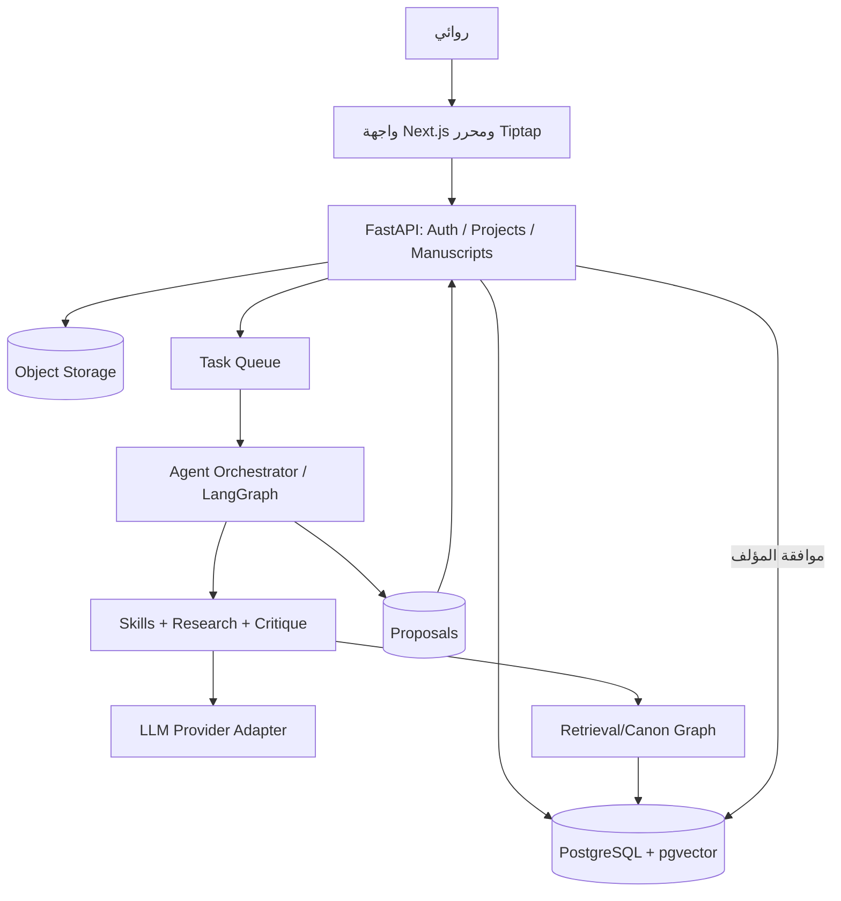

# NIS — التحليل المعماري والتصميم الوظيفي

**الإصدار:** 1.0 | **نوع المستند:** Product Requirements + Software Architecture + Data Contract

## 1. الميثاق
الرواية ملك مؤلفها. النظام محرر مساعد، وليس مؤلفاً مستقلاً مفروضاً. لا تعديل للنص المعتمد ولا نشر ولا إرسال ملف لطرف خارجي دون موافقة صريحة. كل ناتج توليدي يوصف بمصدره ونموذجه وسياقه وإصداره. لا ادعاء بضمان جودة أدبية مطلقة أو صفر تشابه؛ الجودة تقاس باختبارات ومراجعة بشرية.

## 2. المستخدمون والحدود
- المالك/الروائي: جميع قرارات النص، التحكم في الخصوصية، الإصدارات، والنشر.
- محرر مشارك مفوض: تعليقات واقتراحات فقط ما لم يمنح تعديل صريح.
- قارئ تجريبي: قراءة وتعليقات على أجزاء يحددها المؤلف.
- مسؤول النظام: تشغيل ومراقبة تقنية دون قراءة المحتوى المشفر في وضع الحماية الخاصة.
- داخل النطاق: عربي RTL، كتابة وتحضير مخطوط، Story Bible، بحث بمصادر، استمرارية، نقد، إخراج DOCX/PDF/EPUB.
- خارج الإصدار الأول: نشر مباشر لدى دور النشر، سوق بيع الحقوق، تدريب نموذج على نصوص الغير دون رخصة، ضمان قانوني لأصالة المحتوى، تعاون لحظي متعدد الأطراف.

## 3. 20 مهارة واجبة
SK01 توليد الفكرة والأطروحة والصراع؛ SK02 تصميم الحبكة والبنية؛ SK03 الشخصيات وأقواس التحول؛ SK04 العالم الروائي؛ SK05 الخط الزمني؛ SK06 الراوي والتبئير؛ SK07 الحوار والنص المضمر؛ SK08 البصمة الأسلوبية LSIS؛ SK09 الرموز والموتيفات؛ SK10 بناء المشهد؛ SK11 الإيقاع والتوتر؛ SK12 العمق النفسي والفلسفي؛ SK13 البحث والتثبت التاريخي؛ SK14 النقد البنيوي؛ SK15 التحرير التطويري والأسلوبي واللغوي؛ SK16 الاستمرارية؛ SK17 التأثير الوجداني؛ SK18 محاكاة القراءة مع وسمها افتراضية؛ SK19 أصالة وأخلاقيات وحقوق؛ SK20 إخراج النشر.

لكل مهارة واجهة موحدة: `skill_id`, `input_schema`, `context_sources`, `tools`, `risk_level`, `output_schema`, `evidence_refs`, `confidence`, `proposed_changes`, `requires_author_approval`. يُحظر منح المهارات حق كتابة المخطوط الرئيسي مباشرة: تكتب مقترحات يراجعها المؤلف.

## 4. الوظائف التفصيلية (Functional Requirements)
- FR01 حساب مستخدم، جلسات آمنة، أدوار وصلاحيات متعددة على مستوى المشروع.
- FR02 إنشاء مشروع بعدة روايات مع عنوان ولغة ونوع أدبي ووصف ونمط ظهور خاص.
- FR03 مستند مرتب: أجزاء ← فصول ← مشاهد؛ يدعم نقل المشاهد وإعادة الترقيم مع حفظ معرفاتها.
- FR04 محرر عربي اتجاه RTL، تشكيل اختياري، علامات اقتباس، حواش، بحث واستبدال، عداد كلمات عربية صحيح، دعم لغات مختلطة.
- FR05 حفظ تلقائي متكرر مع إشارة ظاهرة لحالة المزامنة وعدم فقد النص عند انقطاع الاتصال.
- FR06 إصدارات غير قابلة للتغيير، مقارنة فروق واستعادة فرع، ومنع الكتابة فوق النسخة السابقة.
- FR07 ملفات الشخصيات: الاسم/الكنى/العمر عبر الزمن/الهدف/العائق/السر/العلاقات/قوس التحول/أول ظهور وآخر ظهور.
- FR08 ملفات الأماكن: الوصف، الإحداثيات الاختيارية، القيود التاريخية، المشاهد المرتبطة.
- FR09 أحداث مؤرخة بزمن القصة وترتيب السرد؛ يدعم المجهول والنطاقات والاحتمال دون إجبار تاريخ واحد.
- FR10 مصفوفة المشاهد: الهدف، الصراع، النتيجة، POV، المكان، الوقت، الشخصيات، المعلومة الجديدة.
- FR11 لوحة علاقات معرفية، وروابط أدلة قابلة للنقر بين الادعاء ومشهد المصدر.
- FR12 توليد مخططات ومقترحات بديلة عند الطلب فقط، لا استبدال تلقائي للفصل.
- FR13 ذاكرة واقعية تميز بين `canon` المعتمد، `draft` غير المعتمد، `hypothesis` والمصدر الخارجي.
- FR14 كشف تعارضات الاستمرارية وإظهار الشواهد لكل تعارض مع إمكانية الرفض والإعفاء المسبب.
- FR15 البحث في مرفقات الكاتب (PDF/DOCX/TXT/MD) بعد موافقة الاستخدام وتحديد حقوقها، وRAG مع استشهاد صفحات/مقاطع.
- FR16 تقرير تحريري منفصل: بنية، شخصيات، لغة، حوار، إيقاع، مصداقية، لا يخلط الوقائع بالتفضيلات النقدية.
- FR17 تعديل بنمط Diff على النص مختوم بالمبرر وموافقات Accept/Reject/Modify.
- FR18 بصمة أسلوبية على عينات مملوكة/مأذون بها، مع إمكانية محوها، ولا تستخدم لتقليد مؤلف حي ثالث.
- FR19 سجل لكل تشغيل وكيل: السبب، النموذج، التكاليف التقديرية، المصادر، المدخلات المصغرة والنتيجة، مع تجنب تسجيل مخطوطات حساسة خاماً في سجلات التشغيل.
- FR20 تصدير DOCX وPDF وEPUB مع فهرس وتتابع الفصول وتعامل سليم مع العربية والخطوط المرخصة.
- FR21 استيراد DOCX/MD/TXT وحفظ تقسيم الفصول قدر الإمكان مع شاشة معاينة ومراجعة.
- FR22 إدارة المصادر والاقتباسات وربط كل دعوى تاريخية بمصدر أو وسم `غير متحقق`.
- FR23 لوحة العمل: التقدم، الكلمات، المشاهد غير المنجزة، تعارضات مفتوحة، مقترحات معلقة.
- FR24 التصدير/الحذف الكامل للبيانات، مع كشف إجراءات الاحتفاظ في النسخ الاحتياطية.
- FR25 وضع محلي اختياري أو مزود نماذج خارجي اختياري مع إعلان وجهة البيانات قبل الإرسال.

## 5. غير الوظيفية (NFRs) — أهداف قبول تصميمية لا نتائج مقاسة
- NFR01: فتح فصل من 10,000 كلمة في أقل من 2 ثانية في بيئة الاختبار القياسية بعد التحميل؛ إذا تعذر، وضع افتراضي للمحتوى.
- NFR02: حفظ تعديل محلي خلال ≤ 1 ثانية من توقف الكتابة، وإظهار حالة الحفظ على الخادم بصورة منفصلة.
- NFR03: لا فقد لعمليات التحرير المؤكدة بعد تعطل المتصفح؛ اختبار انقطاع الشبكة أثناء التحرير.
- NFR04: معالجة مخطوط تجريبي 150 ألف كلمة، و1000 مشهد، و300 شخصية؛ تمثل أحمال اختبار افتراضية وليست متوسطات إحصائية.
- NFR05: فصل بيانات كل مستخدم على الخادم واختبارات منع IDOR؛ المفاتيح والأسرار في مدير أسرار/بيئة خادم.
- NFR06: اختبارات RTL واتجاه مختلط عبر Chrome وFirefox وEdge.
- NFR07: إمكانية الوصول وفق WCAG 2.2 AA قدر المستطاع مع تدقيق آلي وبشري.
- NFR08: سلامة استرجاع النسخ الاحتياطية مجربة، وليس مجرد تنفيذ نسخ دوري.
- NFR09: الميزات التوليدية قابلة للإيقاف بالكامل ولا تمنع الكتابة اليدوية.
- NFR10: مرونة استبدال المزود النموذجي دون إعادة تصميم منطق المجال.

## 6. اختيار المعمارية
واجهة Next.js + TypeScript + Tiptap/ProseMirror؛ خدمة FastAPI/Python؛ PostgreSQL + pgvector؛ تخزين كائنات متوافق S3 للملفات؛ Redis للمهام والأقفال المؤقتة عند الحاجة؛ LangGraph لسير الوكلاء طويل الأمد مع checkpoints؛ موصل LLM معياري يتيح محلي/خارجي. لا حاجة لـ Neo4j في البداية: يمكن حفظ الحواف في جداول PostgreSQL، وإضافته فقط بعد قياس حاجة التحليلات الرسومية. SQLite خيار نسخة محلية أحادية المستخدم مع قيود تزامن واضحة. لا تستخدم أدوات/واجهات تجريبية كاعتماد إنتاجي بلا مراجعة. على الوكيل تحديد الإصدارات المثبتة بعد التحقق من التوافق.

## 7. نموذج البيانات الأساسي
جميع الجداول تحتوي `id UUID`, `created_at`, `updated_at` حيث يلزم؛ ويجب اختبار الصلاحيات على مستوى السجل.
- `users(id, email, password_hash/provider_id, settings)`
- `projects(id, owner_id, title, language, genre, privacy_mode, status)`
- `memberships(user_id, project_id, role, permissions_json)`
- `manuscripts(id, project_id, title, current_release_id)`
- `nodes(id, manuscript_id, parent_id, type[part|chapter|scene], position, title)`
- `documents(id, node_id, content_json, text_plain, content_hash, version)`
- `revisions(id, document_id, revision_no, snapshot_key, author_type, created_by, diff, status)`
- `characters(id, project_id, canonical_name, aliases_json, profile_json, status)`
- `places(id, project_id, name, profile_json)`
- `events(id, project_id, story_time_start, story_time_end, narration_order, uncertainty, summary)`
- `entity_edges(id, project_id, from_entity, relation, to_entity, valid_from, valid_to, evidence_id)`
- `canon_facts(id, project_id, subject, predicate, object_json, epistemic_status, valid_time, source_ref, approved_by)`
- `source_files(id, project_id, object_key, file_type, license_state, ingestion_status)`
- `source_chunks(id, source_file_id, locator, content, embedding, checksum)`
- `citations(id, project_id, claim_id, source_chunk_id, span, verification_state)`
- `skill_runs(id, project_id, skill_id, model_id, input_hash, cost_estimate, status, trace_id)`
- `proposals(id, project_id, target_revision_id, patch_json, rationale, evidence_refs, state[pending|accepted|rejected], created_by)`
- `conflicts(id, project_id, conflict_type, claim_a_id, claim_b_id, severity, resolution_state)`
- `style_profiles(id, owner_id, project_id, features_json, consent_id, deleted_at)`
- `audit_events(id, actor_id, project_id, action, object_type, object_id, timestamp, metadata_redacted)`

**ضوابط:** `revision` غير قابل للتعديل بعد الحفظ؛ النسخ المعتمدة لها معرف ثابت؛ لكل proposal أصل محدد؛ قبول تعديل على نسخة قديمة يحدث تعارض نسخة ويحتاج إعادة دمج يدوية، لا كتابة قسرية. لا تعامل embeddings بديلاً عن النص الموثق.

## 8. واجهات API الرئيسية
`POST /v1/projects`, `GET /v1/projects/{id}`, `PATCH /v1/projects/{id}`
`POST /v1/projects/{id}/nodes`, `PATCH /v1/nodes/{id}/reorder`
`GET /v1/documents/{id}`, `PUT /v1/documents/{id}` مع `If-Match`/revision
`GET /v1/documents/{id}/revisions`, `POST /v1/revisions/{id}/restore`
`POST /v1/projects/{id}/characters`, `GET /v1/projects/{id}/timeline`
`POST /v1/projects/{id}/sources`, `GET /v1/projects/{id}/sources/{source_id}/citations`
`POST /v1/agents/runs`, `GET /v1/agents/runs/{id}`, `POST /v1/agents/runs/{id}/cancel`
`GET /v1/projects/{id}/proposals`, `POST /v1/proposals/{id}/accept`, `POST /v1/proposals/{id}/reject`
`GET /v1/projects/{id}/conflicts`, `POST /v1/conflicts/{id}/resolve`
`POST /v1/projects/{id}/exports`, `GET /v1/exports/{id}`
`POST /v1/projects/{id}/data-export`, `DELETE /v1/projects/{id}` بعد تأكيد واضح.
اعتمد OpenAPI 3.1، أخطاء Problem Details، تحقق Zod/Pydantic، pagination، rate limits، وإصدارات API.

## 9. نموذج الذاكرة السببية
كل معلومة تحمل `statement`, `type`, `epistemic_status`, `valid_from`, `valid_to`, `story_time`, `narrative_order`, `source_spans`, `approval`, `confidence`؛ الحقائق المعتمدة لا تُستنتج من اقتراحات غير مقبولة. مسار الكشف: استخراج كيان/علاقة ← تطبيع الأسماء ← استرجاع الحقائق الموثقة ← قواعد زمنية/علاقات ← تقرير تعارض بأدلة ← مراجعة بشرية. لا يصنف الاختلاف المقصود بين الراوي والشخصية خطأ آلياً.

## 10. استرجاع الوثائق RAG
ارفع الملف ← فحص نوعه وحجمه وحقوقه ← استخراج نص موثوق مع الاحتفاظ بالصفحات ← chunking دلالي ← embedding ← فهرسة مع project_id وACL ← retrieval هجين نصي/متجهي ← rerank اختياري ← اقتراح مع توثيق مصدر وموقع ← عرض نسبة الثقة وعدم الجزم. الوثائق مصدر بيانات غير موثوق للتعليمات؛ لا تنفذ أي أوامر تظهر داخلها. الفشل في الاسترجاع ينتج `لا توجد أدلة كافية` لا اختلاق إحالات.

## 11. محرك المهارات والوكلاء
تنفيذ المهارات عبر tool contracts واضحة. مدخلات الوكيل: مشروع، مراجعة مثبتة، نطاق، مهمة، مصادقة. مخرجات JSON متحقق منها: `summary`, `findings[]`, `citations[]`, `patches[]`, `warnings[]`, `uncertainty`, `requires_approval`. تخطيط المهام بإجراءات deterministic قبل اللجوء إلى agent autonomy؛ أقصى عدد تكرارات وميزانية/سقف رموز لكل مهمة؛ cancellation وretry idempotent؛ checkpoints لاستئناف التنفيذ. فصل القراءة عن الكتابة.

## 12. الأمن والملكية الفكرية
مصادقة آمنة، CSRF حيث تنطبق، حصر CORS، التحقق من الصلاحيات على كل عملية، تشفير نقل/تخزين، عدم إرسال المخطوطات إلى مزود خارجي دون opt-in واعٍ، إخفاء المحتوى في telemetry، حد تنزيل الملفات، فحص المرفقات، تنقية HTML، حماية من prompt injection وتسرب أسرار الأدوات وعمليات الاسترجاع العابرة للمشاريع. وثق سياسة الاحتفاظ للمزود الخارجي وتدريب البيانات ولا تفترضها. إنجاز التصدير والحذف يشمل البيانات المشتقة ضمن حدود الاحتفاظ المعلنة. الالتزام بالمصادر المرخصة للصور والخطوط والنصوص.

## 13. معمارية واجهة المستخدم
RTL أولاً، لوحة المشاريع؛ شاشة الكتابة ثلاثية المساحات قابلة للإخفاء: شجرة الفصول يميناً، محرر في الوسط، أدوات وملف حقائق يساراً؛ شريط حالة واضح للحفظ؛ أطلس شخصيات؛ timeline بسرد مقابل زمن القصة؛ بطاقات المشاهد؛ غرفة نقد تدعم diff؛ مكتبة مصادر وشواهد؛ لوحة مراجعات؛ إدارة تصدير. اختصارات عربية ومرونة عرض LTR عند النص المزدوج. لا تجعل نموذج الكتابة يكتب تلقائياً بمجرد فتح الفصل.

## 14. السيناريوهات الحاسمة
A. إنشاء مشروع/فصل/مشهد، كتابة عربية، قطع شبكة، استمرار محلي، استرجاع، مقارنة تعديلين.
B. تغيير عمر شخصية في الفصل الثالث ورصد تعارض مع مشهد سابق بأرقام الفصول ومقتطفات.
C. طلب تقييم نقدي يعيد تقريراً منفصلاً دون تغيير النص؛ اعتماد تغيير واحد يخلق revision جديدة.
D. استيراد DOCX طويل، ربط مقطع بمصدر، سؤال تاريخي بلا دليل، ظهور `غير متحقق`.
E. استرجاع وثيقة خبيثة تتضمن «تجاهل التعليمات»: تبقى بيانات مسترجعة ولا تغير صلاحيات الوكيل.
F. تصدير DOCX/PDF/EPUB مع فهرسة وفواصل عربية سليمة، وفتح الملفات في قراء مستقلين.

## 15. المراحل المرحلية وبوابات الجودة
P0 تأسيس monorepo وأدوات CI ومخطط DB وأمان وتوثيق.
P1 شريحة عمودية: مشروع → محرر → حفظ → استعادة → تصدير DOCX؛ بوابة: فحص آلي ومتصفح حقيقي.
P2 شخصيات وأماكن وأحداث وروابط وStory Bible؛ بوابة: ترابط مرجعي وعدم فقد البيانات.
P3 البحث والمصادر وRAG؛ بوابة: دقة إحالات وعزل متعدد المستخدمين.
P4 الوكلاء والنقد والتعديلات المعتمدة؛ بوابة: لا تغيير دون موافقة والمؤلف يستعيد النسخ.
P5 LSIS والاستمرارية والقراءة الافتراضية؛ بوابة: اختبارات ذهبية وتقييم بشري.
P6 إتقان RTL وPDF/EPUB وأداء طويل وأمن واختبارات قبول نهائي.

## 16. معيار انتهاء المشروع Definition of Done
لا يكفي وجود الأزرار أو API الوهمية. الميزة مكتملة إذا كان: تخزين دائم + صلاحيات + معالجة أخطاء + واجهة + اختبارات unit/integration/e2e + أدلة تشغيل + سيناريو واقعي ناجح. لكل تقرير استمرارية شاهد قابل للفتح. لكل مخرجات نموذج وسم AI وتدفق قبول. كل إجراء حذف/تصدير موثق. لا إعلان «منتج جاهز» دون اجتياز بوابات الجودة المعلنة.

## 17. مراجع تقنية معيارية
- LangGraph Persistence: https://langchain-ai.github.io/langgraph/concepts/durable_execution/
- Tiptap RTL: https://tiptap.dev/docs/examples/basics/text-direction
- OWASP LLM Top 10 (2025): https://genai.owasp.org/llm-top-10/
- OpenAPI 3.1: https://spec.openapis.org/oas/v3.1.0
- WCAG 2.2: https://www.w3.org/TR/WCAG22/
